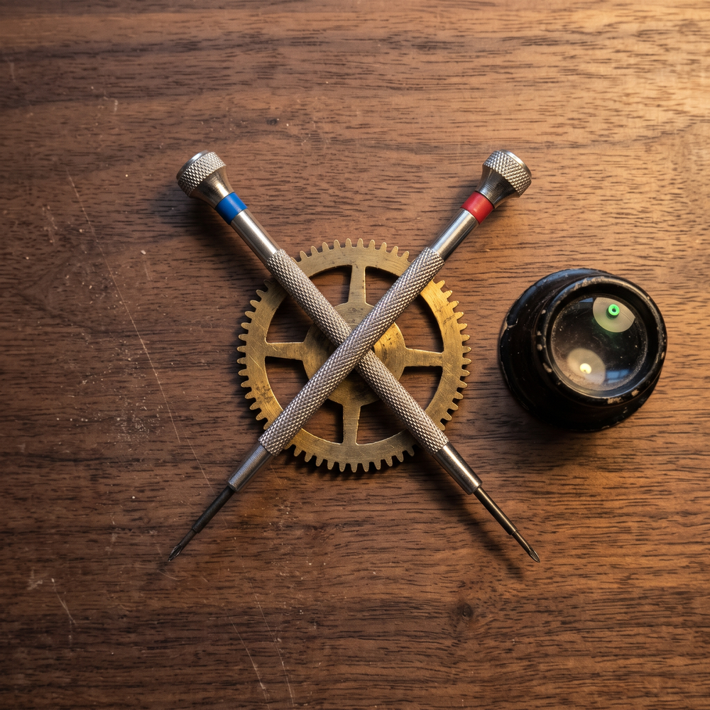

# MacOS-Hardening-Toolkit

<p align="center"></p>


> **Keeper's note:** both scripts need administrator rights and make system wide changes. Read a script line by line before you run it, the way every instrument on this bench gets checked before it is trusted.

A personal collection of two macOS privacy and security shell scripts,
both generated with [privacy.sexy](https://privacy.sexy/) (v0.13.7,
December 2024) from a hand-picked tweak selection and kept here for
reuse. Read a script before running it: both need administrator
privileges and make system-wide changes.


## privacy-script.sh (apply)

The main hardening and cleanup script. It re-runs itself with `sudo`
when it is not started as root, then works through roughly 150 actions,
including:

- Clearing shell histories, system and application logs, and diagnostic
  data
- Clearing browser data for Chrome, Safari, and Firefox, including
  histories, caches, cookies, and saved Firefox passwords
- Clearing developer and app caches (Homebrew, NPM, Yarn, Docker,
  Xcode, and others) and iOS device backups, emptying the Trash, and
  clearing the DNS cache
- Resetting macOS privacy (TCC) permissions: camera, microphone,
  accessibility, screen capture, contacts, calendar, photos, full disk
  access, and more
- Disabling telemetry for Firefox, Microsoft Office, Homebrew, .NET,
  and PowerShell, and removing the Google Software Update service
- Disabling Siri and remote management, remote Apple events, AirDrop,
  and Spotlight indexing
- Enabling the application firewall, firewall logging, and stealth
  mode, requiring a password on wake, and disabling guest access,
  remote login (SSH/SFTP), TFTP, and telnet

This is destructive by design: deleted histories, passwords, logs, and
backups do not come back. There are real trade-offs, so skim the
section headers (`echo '--- ...'` lines) and remove anything you do
not want before running it.


## security_enable.sh (mostly revert - read before running)

Despite its name, this second script is mostly the revert companion
for a different, smaller set of tweaks. It:

- Clears the File Quarantine events database and removes the
  quarantine attribute from files in `~/Downloads`
- Restores the quarantine database immutability handling and deletes
  the `LSQuarantine` preference (re-enabling the downloaded-file
  warning)
- Enables Gatekeeper if it is currently disabled, and writes
  `GKAutoRearm -bool false`
- Turns automatic software update checks, downloads, and installs
  back on, including App Store app updates, configuration data, and
  critical updates

Running it undoes those particular hardenings. It does not revert
anything `privacy-script.sh` does; the two scripts cover different
tweaks. Do not run it expecting it to harden a system.

Two small deviations from the generated export live in
`security_enable.sh`, each marked with an in-file comment where it
sits. The Gatekeeper version gate used `-le 10` in its first clause,
which swallowed its own second clause, so the enable path only ever
ran on macOS 11 and later; the first clause is now `-lt 10`, and the
gate skips only below 10.7. The quarantine attribute loop passed
each file name as a quoted placeholder inside the inner `sh -c`
text, so a file name containing a double quote broke that file
iteration; the name now arrives as the inner shell first positional
argument instead. Nothing else in the generated bodies was changed.


## Usage

```bash
chmod +x privacy-script.sh security_enable.sh
./privacy-script.sh
```

Each script pauses at the end waiting for a keypress. When stdin is
not a terminal the pause is skipped and the scripts exit 0 on success.


## Tests

```bash
python3 -m unittest discover -s tests
```

7 tests, all passing when I last ran them on a Linux host. Neither
script is run by the suite: both need a Mac and change system state.
The tests check `bash -n` on both scripts and the generator headers,
then pull the Gatekeeper gate condition and the quarantine find
block out of `security_enable.sh` itself and run those pieces
against stubbed version numbers and a stub `xattr`, including a
Downloads file whose name contains a double quote. That is static
and stub verification only. No Mac run is claimed.


## License

GPL-3.0, see the LICENSE file. The scripts themselves were generated
by privacy.sexy; see that project for the underlying tweak
documentation.
